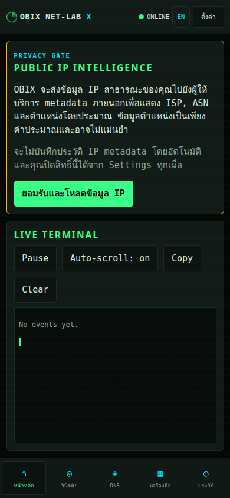
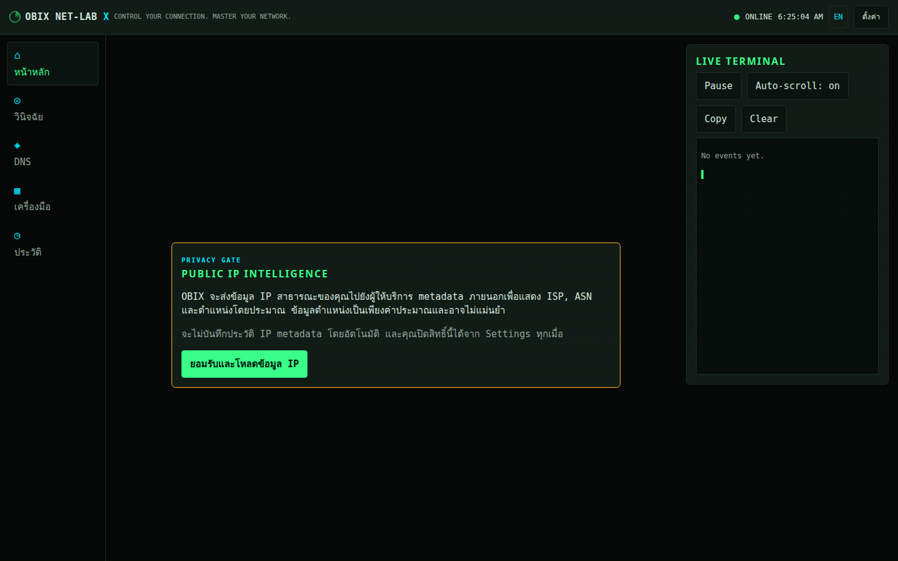
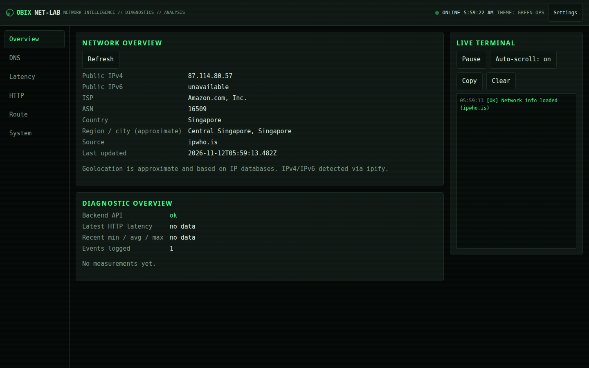
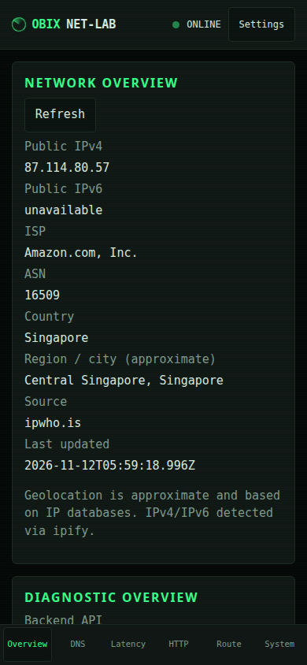

# OBIX NET-LAB X

**CONTROL YOUR CONNECTION. MASTER YOUR NETWORK.**

Mobile-first, open-source network intelligence workstation for Android Chrome, iOS, tablet and desktop. Built with React, TypeScript, Vite and Vercel Functions. Core tools do not require an account, database or paid API.

## What is implemented on this branch

The existing V0.1 diagnostics remain available and are wrapped in a new mobile command-center shell with HOME, DIAGNOSE, DNS, TOOLKIT and HISTORY navigation. The shell supports Thai by default with an English switcher, safe-area-aware bottom navigation, offline application shell, local history, reduced-motion behavior and explicit online/offline status.

HOME keeps real public IP and backend diagnostics, but external IP metadata is gated behind an explicit privacy consent. DIAGNOSE adds a real one-tap workflow for same-origin health, HTTP RTT, trusted DNS, IPv4 and IPv6 availability. It reports Healthy, Degraded, Unstable or Unavailable and never calls HTTP RTT ICMP ping or cellular-radio latency.

TOOLKIT works offline and includes IPv4/CIDR subnet calculations, binary conversion, domain validation, JSON formatting/minifying, URL encoding, Base64, SHA-256 and HTTP status references. CONNECTION DOCTOR is a local rule-based guide for Wi-Fi, 4G, 5G, VPN and common symptoms, including Android/POCO X6 Pro instructions. HISTORY exports JSON/CSV, copies reports, clears local data and respects a configurable retention limit.

DNS still supports A, AAAA, CNAME, MX, NS, TXT and SOA through fixed Google and Cloudflare DoH providers. HTTP Diagnostics retains method/port/DNS/SSRF/IP-pinning/redirect/timeout/body-protection controls. Route parsing remains local and does not simulate OS traceroute.

## Screenshots

Feature-branch runtime screenshots:





Previous production baseline screenshots:





## PWA and offline behavior

The app includes `public/manifest.webmanifest`, `public/icon.svg` and a versioned `public/sw.js`. The service worker caches only the application shell and same-origin static assets; `/api/*` and external network responses are never cached. Toolkit, Doctor, settings and local history are available offline. Online diagnostics show an offline/unavailable result when the browser cannot reach the network.

## Development and verification

```bash
npm ci
npm run lint
npm run typecheck
npm test
npm run build
npm run dev
```

The feature branch verification completed with ESLint passing, TypeScript typecheck passing, **54 tests passing**, and Vite production build passing. Production dependencies report no audit vulnerabilities; dev-tool audit status should be reviewed separately when upgrading the toolchain.

## Architecture

```text
Browser (React)
  ├─ local Toolkit / Doctor / LocalStorage history
  ├─ fixed DoH: dns.google, cloudflare-dns.com
  ├─ ipify availability checks (only during diagnostics/overview)
  └─ /api/health | /api/ip | /api/inspect-url (Vercel Functions)
                                      └─ validated + IP-pinned outbound request
```

`src/lib/` contains pure stats, DNS, validation, storage, toolkit, doctor and diagnostic logic. `src/modules/` contains the command center, Diagnose, DNS, Toolkit, History and preserved legacy workbenches. `api/_lib/ssrf.ts` was not weakened or changed on this branch.

## Privacy and security

IP metadata lookup is opt-in. The app labels location as approximate and does not store IP metadata history. The HTTP inspection endpoint keeps HTTP/HTTPS-only, ports 80/443, credential blocking, private/loopback/link-local/metadata blocking, DNS validation, IP pinning, redirect validation, timeout, response-size and no-body-exposure protections. See [SECURITY.md](SECURITY.md).

The current serverless rate limiter is best effort because its in-memory bucket is not shared across Vercel instances. A hard distributed limit requires a shared store or Vercel Firewall; this branch does not silently add a paid integration or fake a guarantee.

## CI and delivery

GitHub Actions is defined in `.github/workflows/ci.yml` and runs `npm ci`, lint, typecheck, tests and build on `main` and `manus/mobile-premium-upgrade` and on pull requests to `main`.

Repository: <https://github.com/Santipap250/NET-LAB>

Feature branch: `manus/mobile-premium-upgrade`

Vercel project/deployment permissions must be verified in the target team before claiming a preview URL. No credentials are stored in this repository.

## License

MIT. See [LICENSE](LICENSE).
